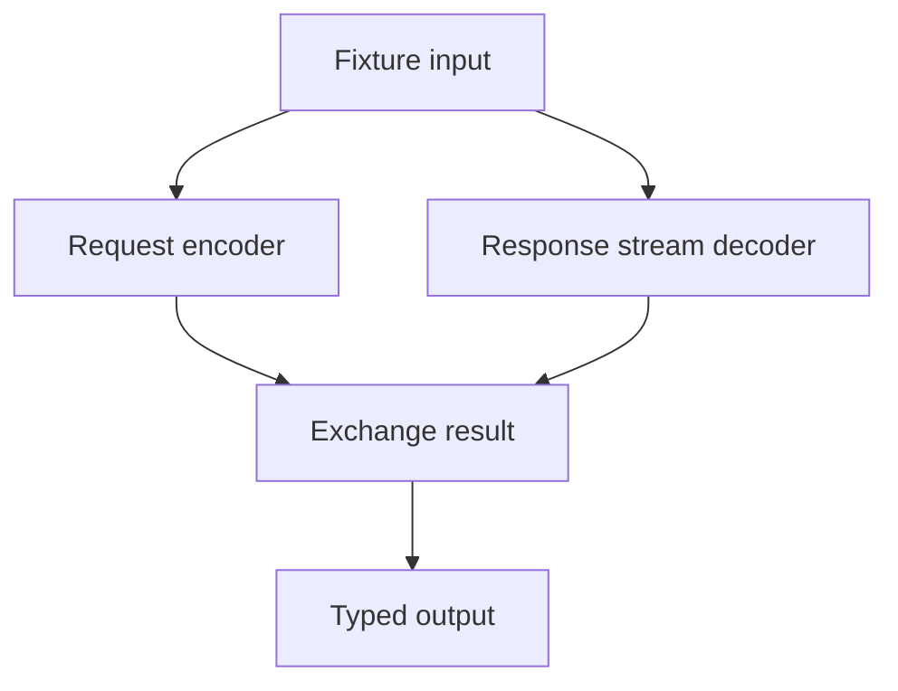

# Core1 source memories

Core1 is an experimental pure Nexa profile for byte processing and source memory composition. Its first example assembles an HTTP/1.1 GET encoder and response decoder from independently sealed memories.

Build the standard Nexa binary with `cargo build --locked`. Run `nexa core1 --help` to see the profile's commands. The default store is `.nexa/core1-store`. An explicit `--store` selects a different store.

| Command | Purpose |
|---|---|
| `core1 seal SOURCE` | Check one source module and return its content digest. |
| `core1 seal SOURCE --import codec=sha256:…` | Bind the source declaration `import codec` to one exact sealed memory. Repeat for additional imports. |
| `core1 inspect DIGEST` | Verify and print the checked export signature, source digest, and direct imports. |
| `core1 inspect DIGEST --closure` | Include checked records for the entire import graph. |
| `core1 run DIGEST --input-file INPUT` | Evaluate the single exported function using typed JSON inputs. |

The sealed record pins the implementation fingerprint, exact source bytes, and import map. Its `type_identity` identifies the namespace used by nominal types in inspected signatures. Sealing and loading recheck the source and exported signature. A dependent memory continues to use the same import digests after another implementation is sealed. Selecting a replacement means explicitly rebinding and resealing its dependents. Core1 uses the existing object store and a profile-specific memory record format.

The dashboard also builds and runs pure Core1 blueprints. Each node selects an exact sealed memory and export. Wires must match the checked port types, including the identity of a nominal type's defining memory. The experimental Core1 draft and compiled program have separate format versions from Slice 0. [Dashboard guide](dashboard.md#run-the-core1-http-proof)

Use an object keyed by parameter name for input. The signature determines how each JSON value is interpreted.

| Nexa type | JSON representation |
|---|---|
| `Bytes` | Lowercase hexadecimal string, such as `"00ff"` |
| `Int` | Signed 64-bit integer in a canonical decimal string, such as `"9007199254740993"` |
| `String`, `Bool`, `Unit` | JSON string, boolean, and null respectively |
| `List[T]` | Array of values encoded using `T` |
| Record | Object containing exactly its declared fields |
| Tagged union | Object containing `variant` and a `fields` object |

Types are nominal across memory boundaries. A type defined by one exact memory and a same-shaped type defined elsewhere are distinct. To exchange a shared record or union, import the memory that defines it. Standard `Result[T,E]` and `Maybe[T]` use the tagged-union representation.

Core1 supports checked signed arithmetic, records, unions, lists, local bindings, branches, exhaustive matches, and loops. Evaluation shares a fuel budget across the entry and all imported calls. `--fuel` selects the budget within the runner's limits. The profile's byte operations and data structures are general-purpose. The source memories implement the HTTP rules.

The blueprint connects the request encoder and stream decoder to the result assembler. The encoder and decoder's header parser share the same decimal scanner.

The [example](../examples/native-http/README.md) and [implementation plan](native-http-client-plan.md) describe the supported exchange and later raw networking milestones. The initial proof uses supplied byte chunks as input. Socket ownership, DNS, TLS, and the full method and framing matrix are later gates.
