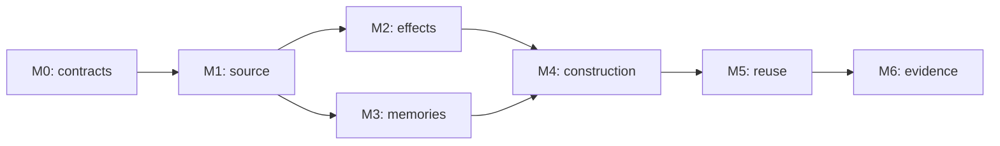

# Nexa milestones

Nexa is being built in small, working increments. The first goal is a functional slice that constructs a program from reusable memories, checks its typed connections, executes its authorized effects, and saves the composition as another memory.

That first program is deliberately simple:

```text
name -> trim memory -> greeting memory -> stdout memory -> Unit
```

For input `{"name":"  Ada  "}`, the completed slice must write exactly `Hello, Ada!\n`. Both a source blueprint and an agent's typed construction request must produce the same resolved program.

This page tracks milestone status and completion criteria. The [functional slice plan](nexa-functional-slice-plan.md) contains the fixtures, architecture, target commands, and full acceptance matrix. The [language specification](nexa-language-specification-0.3.md) defines the intended semantics.

## Current status

| Milestone | Status | Result |
|---|---|---|
| [M0 — Contracts and identity](#m0--contracts-and-identity) | Complete | Typed formats, strict JSON, canonical identities, schemas, and a foundation CLI. |
| [M1 — Source language](#m1--source-language) | Complete | Parse, check, and evaluate actual Nexa source. |
| [M2 — Authorized effects](#m2--authorized-effects) | Complete | Execute the console action under explicit capability and policy checks. |
| [M3 — Memory storage and locks](#m3--memory-storage-and-locks) | Complete | Seal source memories and load exact, verified implementations. |
| [M4 — Program construction](#m4--program-construction) | Complete | Compose, inspect, and run the three-memory greeting. |
| [M5 — Composition as memory](#m5--composition-as-memory) | Complete | Save the greeting blueprint as a memory and reuse it. |
| [M6 — Reproducible slice](#m6--reproducible-slice) | Complete | Demonstrate the full workflow from a fresh checkout and record its evidence. |

**Complete** means the milestone's completion gate has been demonstrated. **Next** identifies the selected next piece of work; it does not mean implementation has started. **Planned** means the work remains ahead. These are completion gates, not calendar estimates.

M0–M6 are implemented and tested. The local Slice 0 workflow now parses source, seals and resolves memories, checks blueprints, runs authorized effects, inspects nested components, and records fixture evidence. Follow the [runnable demo](slice0-demo.md). Broader language features remain in the directions after Slice 0.

## Completion evidence

The gates are exercised by [source tests](../tests/source.rs), [runtime tests](../tests/runtime.rs), [memory tests](../tests/memory.rs), [blueprint tests](../tests/blueprint.rs), [reuse tests](../tests/reuse.rs), and the [subprocess acceptance suite](../tests/acceptance.rs). [Inspection CLI tests](../tests/inspection_cli.rs) cover bounded pagination, cursor validity, and projection. The [demo](slice0-demo.md) reproduces the complete workflow; the [code walkthrough](slice0-walkthrough.md) explains the Rust boundaries.

## Order and dependencies

The intended build sequence is M0 through M6. Source checking enables both effect execution and memory sealing; program construction brings those paths together.



The dependency diagram describes technical prerequisites. We will take the milestones in the listed sequence so each step remains small and reviewable.

## M0 — Contracts and identity

**Status:** Complete. **Depends on:** the agreed 0.3 design.

Establish the typed objects and content identities that later compiler/runtime stages use.

Delivered:

- A Cargo library and CLI with a pinned toolchain and dependency lock.
- Typed wire contracts, identifiers, digests, values, outcomes, and diagnostics.
- Strict JSON decoding and separate raw, semantic JSON, and document hashing.
- Local normalization rules and generated JSON Schemas.
- A kernel descriptor identifying its ABI and implementation inputs.
- Foundation and subprocess tests, plus a [Rust walkthrough](m0-walkthrough.md).

**Completion gate:** equivalent JSON key order and schema-defined collection order preserve identity; semantic changes change identity; invalid numbers, duplicate keys/IDs, and tampered bytes are rejected. Kernel ABI/implementation changes alter its identity. The foundation tests, formatting check, and Clippy pass.

**Try now:** `cargo run --locked -- hash examples/hello/hello.compose.json`. Available commands and setup are in the [README](../README.md#build-and-try-it). A normalized wire object is not an executable checked program.

**Rust focus:** owned newtypes, enums, borrowing, `Result`, traits, serialization, and integration tests.

## M1 — Source language

**Status:** Complete. **Depends on:** M0.

Make the small source subset real: read `.nexa` files, check them, and evaluate their implementations.

Build:

- A lexer and parser with source spans and useful diagnostics.
- AST and checked IR for `String`/`Unit`, parameters, literals, concatenation, calls, and explicit returns.
- Name, argument, return-type, callable-kind, and transitive effect checking.
- An evaluator for pure functions and acyclic helper calls.
- Explicit errors for unsupported syntax and impure calls from `fn`.

**Completion gate:** the [trim](../examples/hello/memories/trim/src/main.nexa) and [greet](../examples/hello/memories/greet/src/main.nexa) fixtures evaluate correctly. Changing the source greeting changes the result without changing Rust. Wrong types and unknown names fail before evaluation; a pure function that calls console output is rejected without writing anything.

Source actions can be parsed and checked here. Authorized host dispatch arrives in M2. Stored-memory resolution and blueprint construction arrive later.

**Rust focus:** recursive enums, exhaustive matching, source ownership, borrowed access, and phase-specific types that keep unchecked input out of evaluation.

## M2 — Authorized effects

**Status:** Complete. **Depends on:** M1.

Run the checked console action under an explicit execution context.

Build:

- Host bindings and a scoped stdout capability supplied by the launcher.
- Policy decisions with deny-dominant composition and fail-closed behavior.
- Authorization immediately before every protected dispatch.
- Structured outcomes, decision records, effect records, and receipts.
- A controlled output sink for tests and clear handling of write failures.

**Completion gate:** the [write action](../examples/hello/memories/write/src/main.nexa) emits the expected bytes only with both host permission and an allow policy. Missing permission, deny, empty/all-abstain policy, and ask produce no greeting. Ask records `AwaitingApproval`; write failures are recorded without automatic retry. Helper calls cannot bypass enforcement.

This milestone exercises checked actions in controlled invocations. End-to-end blueprint execution follows in M4.

**Rust focus:** host-operation traits, I/O boundaries, resource lifetimes, error propagation, and test doubles.

## M3 — Memory storage and locks

**Status:** Complete. **Depends on:** M1 and M0's identity contracts; follows M2 in the build sequence.

Turn checked source implementations into immutable, reusable memories.

Build:

- Source-memory sealing with compiler-derived contracts and confined source paths.
- A local content-addressed store with integrity checks and atomic writes.
- Catalogue labels for discovery and exact dependency/kernel identities for loading.
- Explicit resolution and a lock that pins selector/export bindings.
- Contract/ABI validation when memories are loaded.

**Completion gate:** all three source memories can be sealed and loaded in a fresh process. Changed bytes under an existing digest are rejected. Moving a catalogue alias does not affect locked selection; explicit re-resolution can select the replacement. Sealing and checking invoke no application actions.

**Rust focus:** filesystem APIs, hashing, fallible loading, immutable data, and separation of lookup labels from verified identities.

## M4 — Program construction

**Status:** Complete. **Depends on:** M2 and M3.

Construct the greeting from the three loaded memories and make its blueprint inspectable.

Build:

- Blueprint source parsing and typed-request decoding into one draft model.
- Resolution of exports, exact port-type checks, complete input binding, and one producer per destination.
- Cycle checks across data and control-order edges.
- A derived program contract and normalized ProgramSpec.
- A deterministic scheduler, Pulse execution, and qualified node receipts.
- Bounded JSON inspection of nodes, connections, contracts, effects, and required authority.

**Completion gate:** [blueprint source](../examples/hello/hello.nexa) and the [typed request](../examples/hello/hello.compose.json) produce identical ProgramSpec bytes and digest under the same lock/kernel. The assembly writes the exact greeting. Bad wiring and cycles fail before effects. Missing stdout authority denies the write. Inspection reflects the actual checked graph.

This is the first end-to-end demonstration of constructing a program by reference. The browser inspector can later use this typed inspection model.

**Rust focus:** graph traversal, deterministic collections, typed connections, shared library APIs, and separation of construction from execution.

## M5 — Composition as memory

**Status:** Complete. **Depends on:** M4.

Use the completed blueprint to create a new memory, then use that memory as a component.

Build:

- ProgramSpec sealing with an export derived from its external inputs/result.
- Pinned references to its graph and component dependencies.
- Nested blueprint execution and expandable inspection.
- Inherited execution context with no permission or budget expansion.
- Rejection of dependency cycles.

**Completion gate:** the [reuse blueprint](../examples/hello/reuse.nexa) invokes the saved greeting memory in a fresh process and produces the same greeting and leaf console effect. Its program identity and receipt hierarchy may differ. Inspection expands the saved composition into the original three components, and removing stdout authority still denies the inner write.

This proves that the typed blueprint supplies the executable structure and derived contract of another memory. Descriptions, domain assumptions, and applicable evidence remain explicit additions.

**Rust focus:** recursive composition through stable references, reusable interfaces, and context propagation across nesting boundaries.

## M6 — Reproducible slice

**Status:** Complete. **Depends on:** M5 and the integrated earlier milestones.

Make the complete workflow reproducible and support its claims with recorded evidence.

Build:

- A fixture runner and machine-readable reports tied to exact subject identities.
- Acceptance tests using fresh stores and separate processes.
- Complete CLI reproduction instructions and explicit unsupported-feature documentation.
- Evidence references attached to memories without changing executable identity.
- A demonstration covering both successful execution and expected rejection/denial paths.

**Completion gate:** after documented toolchain/dependency setup, a fresh checkout follows [the full command sequence](nexa-functional-slice-plan.md#7-demonstration-command-sequence) and passes [the acceptance matrix](nexa-functional-slice-plan.md#8-acceptance-matrix). It constructs, inspects, runs, saves, and reuses the program. Running the greeting requires no model provider or network service.

At this point, claim `slice0` support only. Passing these fixtures does not establish full language conformance, general model reliability, or server throughput.

**Rust focus:** subprocess testing, durable artifacts, Cargo tooling, diagnostics, and documenting exactly what tests establish.

## After Slice 0

The full design extends beyond the first seven milestones. These directions are planned at a higher level; each needs its own bounded implementation plan before work begins.

| Direction | Demonstration to aim for |
|---|---|
| General-purpose foundation | A useful non-AI CLI using records, tagged unions, typed errors, branches, generics, and local bindings. |
| Semantic memory tooling | Find an applicable implementation, inspect its evidence, and replace a component with precise compatibility/change diagnostics. |
| Structured tasks and resources | A bounded concurrent service with cancellation, state snapshots, and tested cleanup. |
| HTTP components | Assemble a minimal server from pinned memories and exercise it with integration tests. |
| Typed inference | Add one bounded AI feature with explicit context, validated output, budgets, and tool authority. |
| Web inspector | Browse and expand components, edit their connections through the shared model, check the revision, then explicitly run it. |
| Performance | Benchmark a specific assembly against a recorded workload, environment, and latency/error limits. |

Throughput targets such as one million requests per second require evidence for the actual assembly and environment. Component reuse helps construct candidates; it does not automatically establish the target.

## Keeping milestones useful

- Update this status table when a completion gate is demonstrated, with links to the relevant implementation/tests or reports.
- Keep runnable examples and current commands in the README; label future commands in the implementation plan.
- Keep dependencies explicit and add a short decision note when the scope or order changes.
- Record important Rust decisions so the implementation remains understandable and explainable.
- Measure agent context, construction requests, repair iterations, and human review effort before making productivity claims.
