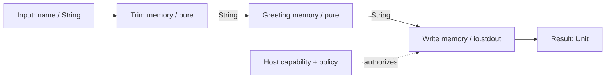

# Nexa: Functional Slice Implementation Plan

**Version:** 0.3 companion plan  
**Date:** 16 November 2026  
**Status:** M0 implemented and verified; M1–M6 remain planned

**Specification:** [Nexa Language Specification 0.3](nexa-language-specification-0.3.md)

**Contents**

- [1. Outcome](#1-outcome)
- [2. Why this program](#2-why-this-program)
- [3. Technical choices](#3-technical-choices)
- [4. Proposed repository](#4-proposed-repository)
- [5. Exact example fixtures](#5-exact-example-fixtures)
- [6. Milestones and gates](#6-milestones-and-gates)
- [7. Demonstration command sequence](#7-demonstration-command-sequence)
- [8. Acceptance matrix](#8-acceptance-matrix)
- [9. Inspection contract for the first slice](#9-inspection-contract-for-the-first-slice)
- [10. Scope and sequencing after Slice 0](#10-scope-and-sequencing-after-slice-0)
- [11. Risks and design checks](#11-risks-and-design-checks)
- [12. Definition of done](#12-definition-of-done)

## 1. Outcome

Build a small Nexa implementation that constructs an executable program from three reusable memories, checks the connections, runs it under an explicit effect permission, exposes its typed blueprint, and saves the composition as a fourth reusable memory.

The first program accepts a name, removes ASCII whitespace at its ends, builds a greeting, and writes one line:

```text
input:  {"name":"  Ada  "}
stdout: Hello, Ada!\n
result: Unit
```

The implementation must evaluate real `.nexa` source from the store. A component name or digest must never select a hardcoded greeting behavior. Replacing a memory with a newly written, type-compatible implementation must change the output through the same parser/checker/evaluator.

This implements `slice0` from specification Section 24. It demonstrates an agent sending references and connections instead of regenerating implementation source. A full application runtime, HTTP server, model integration, and browser inspector follow this first evidence-backed result.

## 2. Why this program

| Component | Callable | Result | Effects |
|---|---|---|---|
| Trim | `trim(name is String)` | `String` | None |
| Greet | `greet(name is String)` | `String` | None |
| Write | `write(message is String)` | `Unit` | `io.stdout` |



The graph carries real values. The output effect requires both a host capability and policy allowance. Denial is observable. The graph can be sealed with one input/result and reused as a single component. Its size lets a human inspect the entire implementation.

A server would add sockets, lifecycle, concurrency, buffers, deployment, and benchmarking before the construction model is established. Slice 0 should first prove parsing, typed composition, execution, inspection, and reuse.

## 3. Technical choices

### 3.1 Reference implementation

Use Rust, edition 2024, with a handwritten lexer/parser, typed AST/Core IR, explicit checking, and an interpreter. This is the agreed reference implementation language. Nexa's language semantics remain independent of its implementation language.

Start with one Cargo package containing a library and a `nexa` binary. Parsing, checking, resolution, construction, and execution live in the library; the CLI calls that same implementation. Interpret checked Nexa IR directly. Keep the scheduler synchronous for Slice 0. Native code generation can be added after the interpreter establishes the semantic fixtures.

Use `clap` for the CLI, `serde`/`serde_json` for versioned wire objects, `sha2` for SHA-256, and `thiserror` for structured implementation errors. A small digest-encoding helper and `tempfile` for tests are sufficient additions. Canonical encoding and duplicate-key validation remain explicit Nexa responsibilities; ordinary `serde_json` serialization alone is not the hashing specification. Commit `Cargo.lock`, record the tested Rust toolchain, and pin the exact toolchain version when the repository is initialized.

Represent syntax, values, decisions, and outcomes with structs/enums and exhaustive matching. Use `Result` for fallible operations and `Option` for genuine absence. Keep source ownership straightforward: a compilation session owns source buffers, spans use source IDs and byte offsets, and AST nodes own their literal data. Borrow immutable data where useful; document intentional copies. Use a privately constructible `CheckedProgram` so the evaluator cannot accidentally execute an unchecked decoded object. Host-operation traits or `std::io::Write` boundaries support controlled implementations and test doubles.

Use a sequential DAG scheduler. Every declared node executes at most once. Arguments evaluate left-to-right; the lexically smallest ready node executes next. `Unit` is a dedicated typed singleton. Values are immutable.

The trusted kernel initially contains only `std.text.trim_ascii` and `std.console.write_line`. Kernel descriptors declare types, effects, capability/resource mapping, failure behavior, ABI, and an implementation build digest. Their content digest is pinned by memory records and locks. Loading verifies the installed implementation identity against that descriptor.

### 3.2 Local store

```text
.nexa/store/
  objects/sha256/<64-hex-digest>
  catalog.json
  evidence-index.json
```

Objects hold canonical semantic JSON or raw source bytes; each reference declares its object kind. Every load verifies the digest and schema. Writes are atomic. An existing address must already contain matching bytes. The catalogue maps human-readable labels to immutable memory identities and never supplies execution authority.

The explicit resolver selects objects from labels. Locked composition and execution never re-resolve labels. No remote registry, vector index, model, or network connection is needed. Evidence reports are immutable separate objects indexed by their subject; another test run does not change executable identity.

### 3.3 Authority

The CLI binds the application principal to its process. `--allow stdout` supplies one scoped stdout handle/capability. An application manifest requests that resource and declares operation-specific policy. The manifest cannot grant capabilities absent from the launch context.

Check authority immediately before every host write, including calls through helper actions or nested memories. Missing permission or policy denies; any deny dominates; ask produces `AwaitingApproval` without output. Slice 0 has no interactive approval continuation.

Receipt writing is CLI infrastructure through an explicitly requested host path. It does not give the Nexa application a filesystem capability. The console operation writes UTF-8 and one LF; a host error may follow partial output and must not trigger automatic retries.

### 3.4 Rust learning and portfolio goals

The implementation should build practical Rust understanding alongside Nexa. Each milestone should include a small working result, meaningful tests, and a short design note explaining the choices made. Work should progress in reviewable increments so the author can follow and change the core implementation confidently.

| Milestone | Rust practice | Explainable result |
|---|---|---|
| M0 | Structs/enums, modules, serialization, `Result`/`Option` | Why a typed program object has a stable identity. |
| M1 | Ownership/borrowing, recursive data, exhaustive matching | How source becomes tokens, AST, checked IR, and an evaluated value. |
| M2 | Traits, I/O, error propagation, scoped resources | Why a host effect cannot bypass authorization. |
| M3 | Filesystem APIs, hashing, validation, immutable data | How pinned memories survive a process restart and detect tampering. |
| M4 | Collections, graph traversal, API design | How typed connections determine a reproducible execution order. |
| M5 | Recursive composition through IDs/references | How nested programs preserve contracts and authority. |
| M6 | Unit/integration tests, subprocesses, Cargo tooling | How the acceptance suite establishes the slice's actual guarantees. |

Use `cargo fmt`, Clippy, and tests throughout. Select Rust abstractions to serve concrete boundaries; the first implementation should remain small enough to explain end to end. Record significant decisions about ownership, error types, host traits, and deterministic ordering. The README should include the runnable demo, architecture, limitations, and the author's actual contribution.

Once the slice is implemented and tested, it can support a specific portfolio description: a Rust interpreter and typed component-composition engine with content-addressed storage, effect authorization, and reproducible execution. Any CV wording should describe the delivered work and the author's contribution, supported by the repository and demonstration.

## 4. Proposed repository

```text
src/
  lib.rs, main.rs, cli.rs, diagnostics.rs
  source/       mod.rs, lexer.rs, parser.rs, ast.rs
  semantic/     mod.rs, types.rs, checker.rs, effects.rs, ir.rs
  memory/       mod.rs, canonical.rs, store.rs, manifest.rs, seal.rs,
                resolve.rs, lock.rs
  blueprint/    mod.rs, draft.rs, normalize.rs, validate.rs, program.rs, inspect.rs
  runtime/      mod.rs, values.rs, evaluate.rs, schedule.rs, context.rs,
                authorize.rs, kernel.rs, receipt.rs
  evidence/     mod.rs, fixtures.rs, reports.rs
schemas/        versioned schemas for memory source, memory, draft, program,
                lock, application, receipt, evidence
examples/hello/
  memories/trim/{memory.json,src/main.nexa}
  memories/greet/{memory.json,src/main.nexa}
  memories/write/{memory.json,src/main.nexa}
  hello.nexa, hello.compose.json, hello.app.json, input.json, fixtures.json
tests/          source.rs, semantic.rs, memory.rs, blueprint.rs, runtime.rs,
                acceptance.rs
Cargo.toml
Cargo.lock
rust-toolchain.toml
README.md
```

This is the target module layout as the slice grows. M0 currently keeps its foundation contracts in top-level library modules; parser, store, and runtime subtrees arrive in later milestones. Combine modules when that simplifies the code without merging authority and parsing boundaries. Run commands during development with `cargo run -- <arguments>`. Installing with `cargo install --path . --locked` supplies the shorter `nexa` used below.

## 5. Exact example fixtures

### 5.1 Source memories

`memories/trim/src/main.nexa`:

```nexa
nexa 0.3
module local.text.trim

export fn trim(name is String) -> String {
  return std.text.trim_ascii(name)
}
```

`memories/trim/memory.json`:

```json
{
  "schema": "nexa.memory-source/0.3",
  "name": "local.text.trim",
  "version": "1.0.0",
  "module": "local.text.trim",
  "sources": ["src/main.nexa"],
  "entry": "trim",
  "kernel": "std.slice0@0.3.0",
  "dependencies": []
}
```

Sealing initializes a store if needed, installs/verifies the bundled kernel, checks the source, and derives its contract. The resulting record pins the exact kernel digest; do not invent hashes in fixture files.

`memories/greet/src/main.nexa`:

```nexa
nexa 0.3
module local.hello.greet

export fn greet(name is String) -> String {
  return "Hello, " + name + "!"
}
```

The greet manifest uses the same schema/fields, with `name` and `module` equal to `local.hello.greet` and `entry` equal to `greet`. Its version, source path, kernel, and empty dependencies match the trim manifest.

`memories/write/src/main.nexa`:

```nexa
nexa 0.3
module local.console.line

export action write(message is String) -> Unit effects {io.stdout} {
  return std.console.write_line(message)
}
```

The write manifest names `local.console.line`, module `local.console.line`, and entry `write`. Sealing derives its effect and protected binding requirements. Declaring an empty effect set while calling console output must fail.

### 5.2 Blueprint source

`hello.nexa`:

```nexa
nexa 0.3
module example.hello

export blueprint hello {
  input name is String
  output result is Unit

  node clean = memory("local.text.trim@1.0.0", export: "trim")
  node greeting = memory("local.hello.greet@1.0.0", export: "greet")
  node write = memory("local.console.line@1.0.0", export: "write")

  connect input.name -> clean.name
  connect clean.result -> greeting.name
  connect greeting.result -> write.message
  connect write.result -> output.result
}
```

### 5.3 Equivalent agent request

`hello.compose.json`:

```json
{
  "schema": "nexa.blueprint-draft/0.3",
  "language": "0.3",
  "profile": "slice0",
  "entry": "example.hello.hello",
  "inputs": [{"name": "name", "type": "String"}],
  "output": {"name": "result", "type": "Unit"},
  "nodes": [
    {"id": "clean", "selector": "local.text.trim@1.0.0", "export": "trim"},
    {"id": "greeting", "selector": "local.hello.greet@1.0.0", "export": "greet"},
    {"id": "write", "selector": "local.console.line@1.0.0", "export": "write"}
  ],
  "connections": [
    {"from": {"kind": "input", "port": "name"},
     "to": {"kind": "node", "node": "clean", "port": "name"}},
    {"from": {"kind": "node", "node": "clean", "port": "result"},
     "to": {"kind": "node", "node": "greeting", "port": "name"}},
    {"from": {"kind": "node", "node": "greeting", "port": "result"},
     "to": {"kind": "node", "node": "write", "port": "message"}},
    {"from": {"kind": "node", "node": "write", "port": "result"},
     "to": {"kind": "output", "port": "result"}}
  ],
  "order_edges": [],
  "settings": [],
  "requirements": []
}
```

Source parsing and request decoding must produce the same normalized draft. With the same lock/kernel, they must produce identical ProgramSpec bytes and digest. This request contains references/connections rather than component implementation source. Nonempty settings or nonstructural requirements are unsupported in Slice 0 and diagnosed; empty arrays retain the full schema shape.

### 5.4 Manifest and input

`hello.app.json`:

```json
{
  "schema": "nexa.application/0.3",
  "principal": "app:hello",
  "requests": [{"capability": "console.write", "resource": "stdout"}],
  "policies": [
    {"operation": "std.console.write_line", "resource": "stdout", "decision": "allow"}
  ]
}
```

`input.json`:

```json
{"name":"  Ada  "}
```

Input decoding requires exactly the declared keys/types. Missing/extra keys and null in place of a string fail before node execution. JSON null encodes `Unit` only where that type is expected; it is never an untyped missing input.

## 6. Milestones and gates

These are dependency gates, not calendar promises. Keep the earliest runnable path working as subsequent features arrive.

### M0. Freeze small contracts

**Implemented:** the Cargo library/CLI, typed wire formats, strict JSON parser, normalizer, content identities, generated schemas, kernel descriptor, and learning guide are present. Validation covers 25 tests plus formatting and Clippy checks. See the repository README and [M0 walkthrough](m0-walkthrough.md). This is contract validation, not source execution or complete Slice 0 conformance.

Implement schema/profile IDs, typed values, diagnostics, canonical JSON, hashes, and the kernel descriptor. Write the source-manifest, lock, draft, ProgramSpec, application, receipt, and evidence schemas. Define operational faults and the CLI exit codes in specification Section 19.

**Gate:** different JSON key order yields the same normalized digest; semantic changes yield different digests; duplicate keys/IDs and malformed input fail; kernel identity changes with its ABI or implementation. Source blobs retain their exact byte hash.

### M1. Parse, check, and evaluate real source

Implement the exact subset with source spans, parameter/`std` resolution, return/argument checking, callable-kind checking, effect derivation, and acyclic helper calls. Unsupported constructs produce explicit diagnostics. The evaluator consumes checked AST/Core IR.

**Gate:** trim/greet execute for the fixtures; a changed literal changes behavior without Rust implementation changes; wrong types and unknown symbols fail; a pure function calling console output fails without writing anything.

### M2. Protect the console effect

Implement context, scoped stdout, policy combination, protected dispatch, and receipts. Define dispatch immediately before the first write. Capture failures without automatic retry. Use a host-supplied trace sink in tests.

**Gate:** write succeeds with capability plus allow, emits no greeting without permission, and emits no greeting under deny, empty/all-abstain policy, or ask. Every outcome records its decision. Helper actions cannot bypass the check.

### M3. Seal and lock memories

Implement immutable source-memory sealing/loading, confined source paths, catalogue selection, ABI/contract validation, and transitive dependency verification. Write selector/export-to-digest bindings and kernel/profile data into the lock. Sealing never invokes source actions.

**Gate:** all three memories load in a fresh process; tampering fails; a moved alias cannot change locked selection; an explicit new resolution sees the replacement; sealing/checking produces no application output.

### M4. Compose, inspect, and run

Decode both construction forms into one draft. Validate exact ports/types, one producer per input, complete binding, one result, data/control acyclicity, and derived effects/resources. Normalize/seal the ProgramSpec, build its Pulse plan, and execute it with the scheduler, evaluator, and protected dispatcher.

Expose bounded JSON inspection with node/port types, source/memory references, connections, effects, capabilities, and unmet requirements.

**Gate:** both construction routes produce identical program identity; the greeting writes exact expected bytes; invalid wiring fails before effects; inspection describes the actual checked object. Missing launch authority denies the write even though pure nodes can complete.

### M5. Remember and reuse the graph

Implement `memory seal --program`. Derive its external callable contract and keep its locked graph/component references. Execute nested blueprint memories under the inherited context with qualified node paths. Reject dependency cycles and permission/budget expansion.

**Gate:** a one-node outer blueprint reuses the whole greeting, produces equivalent output/leaf effect in a fresh process, and still denies without stdout. Inspection expands its three internal nodes. Changing an inner dependency creates a new enclosing identity.

### M6. Produce acceptance evidence

Finish the CLI, fixture runner, reports, README, and clean-room demo. Use temporary stores and subprocesses to prove process-independent loading. Attach checked/test reports without changing executable identity. Keep failure evidence as well as successes.

**Gate:** a fresh checkout runs Section 7, passes Section 8, exposes the graph, and reuses the composed memory. Documentation names unsupported features and claims only `slice0`.

## 7. Demonstration command sequence

These commands describe the target CLI after the full slice is implemented. M0's available commands are documented in the repository README; memory sealing and execution below remain future work. Run from the implementation repository with the Section 5 fixtures present and `nexa` installed, or replace the `nexa` prefix with `cargo run --`. The sealer creates the local store; create `build/` for generated outputs.

```sh
mkdir -p build

nexa memory seal examples/hello/memories/trim --store .nexa/store
nexa memory seal examples/hello/memories/greet --store .nexa/store
nexa memory seal examples/hello/memories/write --store .nexa/store

nexa resolve examples/hello/hello.nexa --store .nexa/store --write-lock examples/hello/nexa.lock

nexa compose examples/hello/hello.nexa --locked --lock examples/hello/nexa.lock --store .nexa/store --out build/hello.program.json

nexa compose --request examples/hello/hello.compose.json --locked --lock examples/hello/nexa.lock --store .nexa/store --out build/hello.from-request.program.json

nexa check build/hello.program.json --profile slice0 --store .nexa/store --json
nexa inspect build/hello.program.json --store .nexa/store --json

nexa run build/hello.program.json --input-file examples/hello/input.json --manifest examples/hello/hello.app.json --allow stdout --receipt build/hello.receipt.json --store .nexa/store
```

The final command writes `Hello, Ada!` and one LF to application stdout, exits 0, and writes a receipt with `Succeeded(unit)` to the requested file. Canonical serialized result value is null with an explicit `Unit` type. Receipts retain exact subject digests; diagnostic output does not contaminate stdout.

The acceptance harness compares canonical bytes and digests of the two ProgramSpec outputs. Source spans and visual layout are sidecars and therefore do not create differences between equivalent constructions.

To test denial, repeat the run command without `--allow stdout`. It exits 3, writes no greeting, and records `Denied`. No application-manifest edit may defeat that missing host authority.

To create the fourth memory:

```sh
nexa memory seal --program build/hello.program.json --name local.hello --version 1.0.0 --store .nexa/store
```

Then write `examples/hello/reuse.nexa`:

```nexa
nexa 0.3
module example.reuse

export blueprint hello_again {
  input name is String
  output result is Unit

  node saved = memory("local.hello@1.0.0", export: "hello")
  connect input.name -> saved.name
  connect saved.result -> output.result
}
```

The sealer exports the original blueprint's local name `hello` as its callable export; its original qualified entry remains provenance. For a general `--program` seal, that local blueprint name is the default export unless an explicit export rename is supplied by a future command version.

```sh
nexa resolve examples/hello/reuse.nexa --store .nexa/store --write-lock examples/hello/reuse.lock
nexa compose examples/hello/reuse.nexa --locked --lock examples/hello/reuse.lock --store .nexa/store --out build/reuse.program.json
nexa run build/reuse.program.json --input-file examples/hello/input.json --manifest examples/hello/hello.app.json --allow stdout --receipt build/reuse.receipt.json --store .nexa/store
nexa inspect build/reuse.program.json --store .nexa/store --json
```

The nested run has a different program identity and node hierarchy but the same intended greeting and one console effect. Its receipt paths identify the nesting, such as `saved/clean`, `saved/greeting`, and `saved/write`. It cannot rely on authority stored in the saved memory.

## 8. Acceptance matrix

Tests validate semantic boundaries and end-to-end behavior. Avoid snapshots of incidental Rust debug representations or timestamp/UUID values. The implementation is complete only when these behaviors are demonstrated. Use module-level `#[test]` checks and Cargo integration tests; subprocess acceptance tests should invoke the compiled `nexa` binary in temporary stores.

The implementation repository's checks are `cargo fmt --all -- --check`, `cargo clippy --all-targets --locked -- -D warnings`, and `cargo test --locked`. These commands become applicable once the Cargo project is created.

| ID | Scenario | Expected evidence |
|---|---|---|
| A01 | Seal the three source memories | Exact source/record identities and derived contracts; no application action invoked. |
| A02 | Execute checked trim/greet source | Correct values for whitespace, empty, and Unicode inputs. |
| A03 | Assemble source and typed-request forms | Byte-identical normalized ProgramSpecs and identical digest. |
| A04 | Run the three-node graph | Exact greeting bytes, `Succeeded(Unit)`, one authorized console effect. |
| A05 | Connect `Unit` result to a `String` input | Type mismatch with both endpoint locations; no execution. |
| A06 | Unknown port, duplicate producer, missing binding/result | Specific construction diagnostics; no execution. |
| A07 | Data-edge or control-edge cycle | Cycle path diagnostic; no execution. |
| A08 | Pure `fn` calls output | Purity/effect diagnostic before any output. |
| A09 | Action omits `io.stdout` from declared effects | Declared/derived effect mismatch. |
| A10 | Missing stdout capability | `Denied`, exit 3, empty application stdout. |
| A11 | Allow plus deny policy | Deny wins; no output. |
| A12 | Empty/all-abstain policy | Fail closed; no output. |
| A13 | Ask policy with valid capability | `AwaitingApproval`, exit 4, no output or retained continuation. |
| A14 | Mutate a source/blob under its old digest | Integrity failure on load; no execution. |
| A15 | Move a catalogue alias after locking | Old lock still selects old object; explicit re-resolution selects new object. |
| A16 | Load and run in another process | Same behavior from stored artifacts without in-memory compiler state. |
| A17 | Seal and reuse the complete blueprint | Correct derived external contract and equivalent output/leaf effect. |
| A18 | Remove stdout authority from the nested run | Inner effect is denied; saved composition supplies no authority. |
| A19 | Execute a new greeting implementation | Output changes through normal source evaluation; no runtime fixture-name branch. |
| A20 | Fresh source with different structure | Nested pure calls/string concatenation evaluate correctly through the generic evaluator. |
| A21 | Reorder input JSON keys and graph arrays | Same normalized identity where order is declared nonsemantic. |
| A22 | Change a component dependency | New parent identity; previous assembly evidence does not silently transfer. |
| A23 | Inspect a nested memory | Expandable node/contracts/source references matching the executed object. |
| A24 | Missing/extra/wrong-typed invocation input | Input diagnostic before any node runs. |
| A25 | Closed stdout or injected kernel write error | `Failed`, exit 1, recorded fault; no automatic retry. |
| A26 | Unsupported inference/task/sensitive annotation syntax | Explicit unsupported-feature diagnostic. |
| A27 | Forge `derived` effects or contract in JSON | Checker recomputes and rejects the mismatch. |
| A28 | Duplicate JSON keys/IDs or malformed digests | Deterministic validation diagnostic; no silent last-write wins. |
| A29 | Append a new evidence report | Executable identity unchanged; evidence index references the new immutable report. |
| A30 | Check/compose/inspect an effectful program | No console action invoked during tooling operations. |

For A20, use newly sealed source such as `return "[" + std.text.trim_ascii(name) + "]"` and verify `[Ada]`. This prevents a superficially working implementation that understands only the exact original greeting expression.

### 8.1 Positive text cases

| Input `name` | Expected stdout, shown with escapes |
|---|---|
| `"  Ada  "` | `"Hello, Ada!\n"` |
| `"\tAda\r\n"` | `"Hello, Ada!\n"` |
| `""` | `"Hello, !\n"` |
| `" Zoë "` | `"Hello, Zoë!\n"` |
| `"\u00a0Ada\u00a0"` | `"Hello, \u00a0Ada\u00a0!\n"` |

The empty-name behavior is intentional for this slice. Domain validation can become a later component; do not silently add different behavior to the kernel. Nonbreaking space is preserved because the selected trim contract is ASCII-only.

### 8.2 Fixture/report format

Use `nexa.fixtures/0.3` with named input objects, expected stdout bytes/string, expected typed result, outcome, and exit code. Each case runs with explicit manifest/permission data. Fixtures contain declarative inputs and expectations, with no executable host-language or shell setup. Negative-store mutations are performed by the test harness as controlled scenarios.

```json
{
  "schema": "nexa.fixtures/0.3",
  "cases": [
    {
      "name": "trimmed-name",
      "input": {"name": "  Ada  "},
      "allow": ["stdout"],
      "expect": {
        "stdout": "Hello, Ada!\n",
        "result": {"type": "Unit", "value": null},
        "status": "Succeeded",
        "exit_code": 0
      }
    }
  ]
}
```

The runner receives the application manifest as an explicit argument or a fixture-suite reference, resolves it once per case, and records its digest. The test command accepts `--manifest <json>` as a common execution option. Reports include the exact program/fixture/manifest/kernel digests, implementation/profile version, effective permission setup, pass/fail per case, and environment. A report's ID is its content digest; the subject's identity is unchanged.

```sh
nexa test build/hello.program.json --fixtures examples/hello/fixtures.json --manifest examples/hello/hello.app.json --store .nexa/store --report build/hello.tests.json
```

## 9. Inspection contract for the first slice

Required operations are inspect program summary, expand node, inspect memory contract/source references, explain a connection, and explain required authority. Implement them as pure library queries and expose them through CLI JSON. Full LSP, natural-language search, change-impact analysis, and incremental editing are later milestones.

The program summary includes schema/protocol/profile, exact subject digest, input/result types, node count, node IDs and selected exports, connection count, effects, capability/resource requirements, evidence references, and unresolved requirements. Node expansion includes nested blueprint children and source spans/references.

Default maximum page size is 50 nodes; requests may lower it. Use stable `(subject digest, node path)` identity. A cursor includes the subject digest and next position; changing the subject invalidates it. The CLI may accept `--node <path>`, `--fields <list>`, `--limit <n>`, and `--cursor <value>` as inspection options.

This data is sufficient for a later web view to draw and expand the graph. The UI should not need to infer types or execution meaning from source text. Visual coordinates belong in a separate sidecar. The first browser UI can arrive after the source/request round trip and nested inspection pass their tests.

## 10. Scope and sequencing after Slice 0

| Stage | Addition | Required demonstration |
|---|---|---|
| Application foundation | Records, tagged unions, `Result`, generics, branches, local bindings, fuller source grammar | A useful non-AI CLI with domain errors and explicit contracts. |
| Better memory workflows | Exact signature/constraint search, provenance/history queries, transactional blueprint edits | Replace a component and receive precise compatibility/change diagnostics. |
| Resource/task runtime | Bounded tasks, cancellation, state snapshots, ownership, timers | A small concurrent service with tested resource cleanup and bounded work. |
| HTTP slice | Versioned network adapter, routing, lifecycle, failure handling | A minimal server assembled from pinned memories with integration tests. |
| AI slice | Typed inference, claims/context, budgets, tool proposals | One bounded AI feature with malformed-output and permission tests. |
| Web inspector | Graph browsing/editing against the shared typed model | Inspect and replace a component, check, then explicitly run the new revision. |
| Performance work | Profiling, alternate executor/native backend as evidence requires | Reproducible benchmarks for named workloads and environments. |

A million requests per second is a possible future requirement, not a property of memory composition. Benchmark the specific server assembly against specified hardware, workload, latency/error limits, and measurement method. Store that evidence so future retrieval can use it appropriately.

## 11. Risks and design checks

| Risk | Concrete response |
|---|---|
| The demo bypasses Nexa source | Acceptance tests seal novel implementations and run them through the same evaluator. |
| Memories are code snippets with unverifiable summaries | Derive types/effects from source, pin dependencies, and revalidate contracts on load. |
| Composition silently writes adapters | Require explicit adapter source/memory and include it in the graph. |
| Saved memory hides authority | Reauthorize leaf effects under the current context; test nested denial. |
| UI/API semantics drift from source | Normalize source and typed requests to the same ProgramSpec and compare identities. |
| A successful component test is mistaken for assembly correctness | Record independent integration evidence for the assembled digest. |
| Mutable catalogue changes reproducibility | Execute only pinned digest closures; alias lookup happens during explicit resolution. |
| Scope expands before a useful result | Keep the Slice 0 exit gate fixed; add one tested capability at a time afterward. |

## 12. Definition of done

Slice 0 is complete when a fresh process can load three real source memories, construct the greeting from either source or a typed request, reject invalid connections, enforce the console permission/policy, emit a truthful receipt, expose the typed graph, seal the graph as a memory, and reuse it under the same rules.

The repository must include the runnable fixtures, automated acceptance evidence, unsupported-feature list, and a short reproduction guide. It must not require a model provider, network service, preloaded in-process objects, or manual edits to fabricated digests.

Before making claims about agent efficiency, measure the implemented workflow: implementation source the agent had to read/write, construction request size, inspection response size, diagnostics/repair iterations, and human review effort. Report cold-store and warm-store work separately. The first goal is a correct end-to-end mechanism; performance and productivity claims follow measured evidence.
